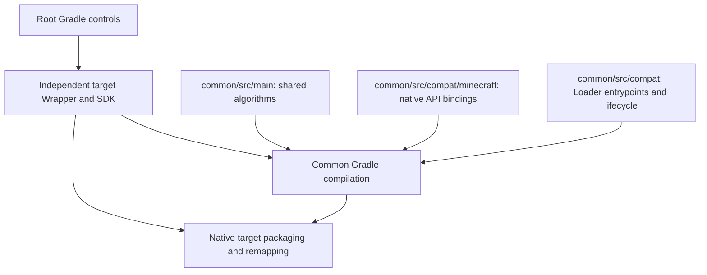

# Multi-version builds

For Fabric and NeoForge, the same `runClient_<target>` entry can load existing release JARs with `-Plightspeed.distributionRun=true -Plightspeed.runDirectory=<instance>`. Put the mod and its runtime dependencies in that instance's `mods` directory first. Fabric uses Loom's production client task; NeoForge uses a separate native run source set without project mod classes. Forge 1.20.1 resolves its existing `build/libs` release through ForgeGradle's native `fg.deobf` dependency pipeline and runs that artifact without the project's main classes; combine the output variant property when using a candidate directory. The normal development run remains available without these properties.

LightSpeedRe uses KltytonTemple's native Gradle controls. Open the repository root in IDEA with the KltytonTemple extension installed. Each target is an independent Gradle build with its own Wrapper and Java toolchain.

| Target | Minecraft / Loader | Java | Build plugin |
| --- | --- | --- | --- |
| forge-1.20.1 | 1.20.1 / Forge 47.4.20 | 17 | ForgeGradle 6.0 |
| fabric-1.20.1 | 1.20.1 / Fabric Loader 0.16.14 | 17 | Fabric Loom 1.10.5 |
| neoforge-1.21.1 | 1.21.1 / NeoForge 21.1.234 | 21 | ModDevGradle 2.0.141 |
| fabric-1.21.1 | 1.21.1 / Fabric Loader 0.16.14 | 21 | Fabric Loom 1.10.5 |
| neoforge-26.1.2 | 26.1.2 / NeoForge 26.1.2.84 | 25 | ModDevGradle 2.0.141 |
| fabric-26.1.2 | 26.1.2 / Fabric Loader 0.19.5 | 25 | Fabric Loom 1.18.2 |
| neoforge-26.2 | 26.2 / NeoForge 26.2.0.88 | 25 | ModDevGradle 2.0.148 |
| fabric-26.2 | 26.2 / Fabric Loader 0.19.5 | 25 | Fabric Loom 1.18.2 |

Use `gradlew.bat listTargets` to list targets, `gradlew.bat build_forge_1_20_1` or `gradlew.bat build_fabric_26_2` to build, and the corresponding `runClient_<target>` task to launch. The default target is NeoForge 1.21.1. Selecting a target chooses its SDK for editing `common`; reload the Gradle models after switching. The selected target owns the physical `common` project, while other targets use separate build contexts without claiming its editor source roots. All targets retain their independent Wrapper and toolchain. Native `addTarget` and `createProject` forms use the local template catalogs. The legacy Fabric builds use Java 21 for Gradle and their listed Java version for compilation. The 26.x builds use Java 25 for both.

Release JARs are produced in each target's `build/libs` directory. Forge retains JarJar, reobfuscation and its generated Mixin refmap. Legacy Fabric uses official Mojang mappings and a generated refmap; 26.x Fabric uses the unobfuscated game directly. NeoForge retains generated Loader metadata. `verify_<target>` inspects the recorded release JAR without rebuilding it. Source archives and slim Forge JARs are kept in `build/intermediates`. Set `-Plightspeed.outputVariant=<name>` on a target build to place its outputs under `build/candidates/<name>`.

Game sources live in the `common` Java-library module. Cache persistence, path discovery, ordered pack lookup, startup worker creation and metrics are maintained once in `common/src/main`. `common/src/compat/minecraft` contains the typed ResourceLocation/Identifier, reload, ZIP-overlay and GUI API bindings. The Fabric, Forge and NeoForge compatibility layers contain native entrypoints, configuration, resource-pack access and lifecycle callbacks. Only the layers for the selected target are compiled, against that target's resolved SDK. Native target plugins retain remapping, generated refmaps, JarJar and Loader metadata packaging. Handwritten resources retain their original maintenance model. The existing embedded bootstrap payload has a separate producer with sources under `common/src/compat/bootstrap`; it is not activated by normal build or run tasks.

The menu's startup duration is JVM uptime at the first title-screen tick after mod loading and the initial resource reload have succeeded and the loading overlay has closed. The menu and `title-screen-operable` log share this frozen value, displayed to milliseconds. Launcher downloads and other work before JVM creation are outside this duration. Later menu visits and resource reloads retain the completed startup value.
