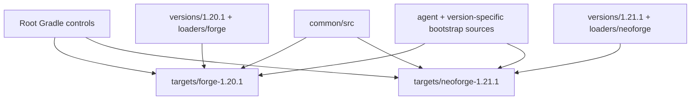

# Multi-version builds

LightSpeedRe uses KltytonTemple's native Gradle controls. Open the repository root in IDEA with the KltytonTemple extension installed; both independent target builds are linked. Each target retains its own Wrapper and Java toolchain.

| Target | Minecraft / Loader | Java | Build plugin |
| --- | --- | --- | --- |
| forge-1.20.1 | 1.20.1 / Forge 47.4.20 | 17 | ForgeGradle 6.0 |
| neoforge-1.21.1 | 1.21.1 / NeoForge 21.1.234 | 21 | ModDevGradle 2.0.141 |

Use `gradlew.bat listTargets` to list targets, `gradlew.bat build_forge_1_20_1` or `gradlew.bat build_neoforge_1_21_1` to build, and the corresponding `runClient_<target>` task to launch. The default target is NeoForge 1.21.1; selecting another default does not change IDEA's target matrix. Native `addTarget` and `createProject` forms use the local template catalogs.

Release JARs are produced in each target's `build/libs` directory. Forge retains JarJar, reobfuscation and its generated Mixin refmap. NeoForge retains generated Loader metadata. `verify_<target>` inspects the recorded release JAR without rebuilding it. Source archives and slim Forge JARs are kept in `build/intermediates`.

Shared cache persistence, neutral encoding and launcher profile handling live in `common`. Version layers own Minecraft API hooks and startup executor lifetimes; Loader layers own registration, configuration, Loader metadata and native resource pack integration. Handwritten resources retain their original maintenance model. The embedded bootstrap payload remains a separate producer and is not activated by normal build or run tasks. Explicit legacy bootstrap checks are separate from ordinary target builds.
